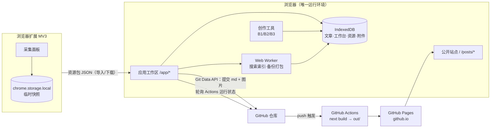
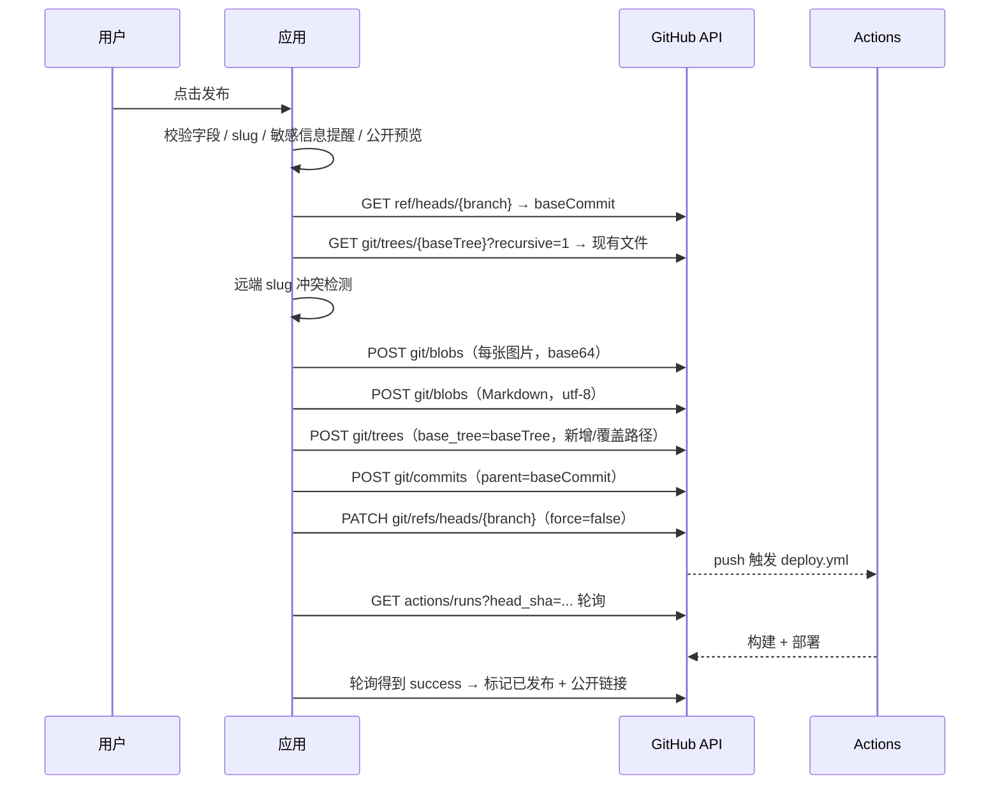

# 个人博客项目 技术设计文档

| 项目 | 内容 |
|---|---|
| 版本 | v1.0（评审稿） |
| 日期 | 2026-11-10 |
| 输入 | [PRD](./PRD.md)、[产品总览](./00-产品总览.md)、[网页聚合](./01-网页聚合与标签整理.md)、[创作工具箱](./02-内容创作工具箱.md)、[成长工作台](./03-个人成长工作台.md) |
| 范围 | 四模块（A/B/C/D）全量技术方案，按 P0 → P1 → P2 落地 |
| 状态 | 待评审 |

**约定**

- 本文只做技术决策，不新增产品规则；与 PRD 冲突时以 PRD 为准并回改本文。
- `[Assumption]` 表示技术侧默认假设，评审可推翻。
- `[TBD]` 表示需在实际实现或联调时验证的数值/细节，不阻塞本文。

---

## 1. 技术目标与约束

### 1.1 目标

1. **零服务器**：全部计算与存储在浏览器本地完成，唯一外部依赖是 GitHub（提交、Actions、Pages）。
2. **一次构建，两类页面**：同一个 Next.js 静态导出产物同时提供公开博客与应用工作区（编辑器、工具、工作台、资源库）。
3. **数据不丢**：自动保存、崩溃恢复、可校验的备份包、Token 与私密数据永不进入公开仓库。
4. **产物可直接用**：公众号富文本复制后样式稳定；长图/首图导出清晰、无水印；博客文章经构建后公开可访问。
5. **单人可维护**：依赖少、无数据库服务、无后端代码；配置以 JSON 文件为准。

### 1.2 硬约束

| 约束 | 技术后果 |
|---|---|
| GitHub Pages 纯静态托管 | 不能使用 SSR / ISR / Route Handler 运行时 / Middleware；Next.js 必须 `output: 'export'` |
| 仓库为 `<user>.github.io` 用户主页 | 站点部署在根路径，`basePath` 与 `assetPrefix` 均为空 |
| 仅 GitHub 外部依赖 | 无图床、无云端 AI、无第三方统计、无 CDN 字体；所有资源同源打包 |
| 无账号体系 | 应用壳公开可访问，但**不含任何用户数据**；隐私边界靠"数据只在本地 + 仅主动发布"实现，不能靠登录 |
| 桌面为主 | 完整功能只保证 Chrome/Edge 桌面版；Safari、移动端仅阅读 |
| 发布是复制而非同步 | 本地文章与仓库文章是两份数据；发布任务记录是二者唯一关联 |
| 无服务端通知 | 构建状态只能由页面轮询或手动刷新获得 |

### 1.3 明确不引入

- 不使用 Vercel/Cloudflare 等运行时平台、不使用 Server Actions、不使用 Edge Function。
- 不引入 Sentry 等上报服务；错误日志只存本地。
- 不引入第三方 UI 组件库的重主题体系（避免体积与样式不可控），设计系统自建。
- 不做 PWA / Service Worker（PRD 未要求，且会引入缓存一致性问题）。

---

## 2. 技术选型

| 层 | 选型 | 理由 | 备注 |
|---|---|---|---|
| 包管理 / 仓库 | pnpm workspace（Monorepo） | 共享类型与纯函数，构建一次；pnpm 磁盘友好、CI 快 | 锁定 `packageManager` 字段 |
| 应用框架 | Next.js App Router + React + TypeScript，`output: 'export'` | 公开站需要 SSG/SEO；工作区与工具需要组件化；一次构建产出两类页面 | 版本在脚手架时锁定最新稳定版 |
| 样式 | Tailwind CSS + CSS 变量设计令牌 | 公开站与工具共用令牌；移动端适配快 | 不使用运行时 CSS-in-JS |
| 公开站渲染 | Next.js SSG（构建期读取 `content/` 与 `site.config/`） | 静态、可缓存、SEO 友好 | 构建产物 `out/` |
| Markdown | unified（remark-parse / remark-gfm / remark-frontmatter / remark-rehype / rehype-sanitize / rehype-slug / rehype-autolink-headings）+ Shiki | 生态成熟；构建期与浏览器端共用同一套插件链，保证"预览即发布" | Shiki 用 JS 正则引擎，浏览器可用 |
| 富文本复制 | 自研 rehype 内联样式插件 + Clipboard API | 公众号只认内联样式；自研可精确控制白名单，预览与复制同源 | 不使用 juice 等 DOM 后处理 |
| Markdown 编辑器 | CodeMirror 6（`@codemirror/lang-markdown`） | 分栏写作、大文档性能稳定、无富文本双向转换的边界问题；体积按路由懒加载 | 不做所见即所得；B1 排版页复用同一组件 |
| 长图渲染 | DOM 测量分页 + `html-to-image` 逐页栅格化 | 用真实排版测量块高度，断页规则可控；避免手写 Canvas 文本排版 | 失败回退 `html2canvas` `[Assumption]` |
| 画布编辑 | Fabric.js（v6 及以上） | 图层、变换、序列化、导出成熟；支持多页工程 JSON | 素材以 assetId 引用 |
| 本地存储 | IndexedDB（Dexie） | 容量远大于 localStorage；支持 Blob 存图片；事务与索引 | 图片/附件存 Blob |
| 全局状态 | Zustand（仅 UI/编辑器瞬时状态） | 轻量，避免 Context 重渲染 | 持久数据一律走 Dexie |
| 表单与校验 | React Hook Form + Zod | schema 同时用于运行时校验、构建期校验、类型推导 | 单一事实来源 |
| 搜索 | MiniSearch + 自实现中文二元分词 | 纯前端、内存索引、5000 条量级足够 | 索引在 Web Worker 构建 |
| 压缩/打包 | `fflate`（zip） | 体积小、支持流式压缩，适合备份包 | 备份包含附件 |
| 哈希 | Web Crypto SHA-256 | 附件去重、备份校验、发布内容指纹 | 浏览器原生 |
| 日期 | `date-fns` + `date-fns-tz` | 本地时区语义明确 | 仅日期与完整时间两类 |
| 浏览器扩展 | Chrome MV3 + Vite + React（popup） | 与主站共享 `packages/core` 类型 | 先 Chrome/Edge |
| 测试 | Vitest + Playwright + MSW | 纯函数单测、关键流程 e2e、GitHub API 可 mock | 无真实仓库依赖的 CI |
| 部署 | GitHub Actions + `actions/deploy-pages` | 与 PRD D1 一致 | 单 workflow |

**不选 Next.js 作为"后端"**：本项目中 Next.js 只承担静态生成与客户端应用壳，不承担任何服务端职责。

---

## 3. 总体架构



### 3.1 运行形态

| 形态 | 地址 | 渲染方式 | 数据来源 |
|---|---|---|---|
| 公开博客 | `/`、`/posts/<slug>/`、`/tags/*`、`/archive/`、`/about/`、`/nav/*`（P1）、`/search/`（P1）、`/rss.xml`、`/sitemap.xml`、`/404.html` | 构建期 SSG | 仓库 `content/` + `site.config/` |
| 应用工作区 | `/app/` 及子路由（客户端路由） | 静态壳 + 纯客户端 | IndexedDB |
| 创作工具 | `/app/tools/*` | 纯客户端 | IndexedDB |
| 工作台 / 资源库 | `/app/workbench/*`、`/app/resources/*`（P1） | 纯客户端 | IndexedDB |

**关于公开性的说明**：`/app/*` 的代码对所有访客可见，但页面渲染前不含任何业务数据；数据只存在于访问者自己的浏览器。任何"通过隐藏入口保护隐私"的设计都不可依赖，隐私保证完全来自"私密数据不上传"。

### 3.2 静态导出的两个关键配置

```ts
// apps/web/next.config.ts
const nextConfig = {
  output: 'export',
  trailingSlash: true,        // GitHub Pages 依赖目录式路径：/posts/x/ -> posts/x/index.html
  images: { unoptimized: true }, // 无 Next 图片服务
  reactStrictMode: true,
};
export default nextConfig;
```

- `trailingSlash: true` 是硬性要求：GitHub Pages 不会把 `/posts/x` 重写到 `posts/x.html`，否则详情页 404。
- 所有应用内动态路由使用**查询参数**（`/app/articles/editor/?id=xxx`），避免静态导出需要穷举动态段；刷新与前进/后退均可用。
- 站内链接统一使用带尾斜杠的绝对路径；不配置 `basePath`。
- `/app/*` 下所有页面一律标注 `'use client'`，顶层不得访问 `window`/`document`/IndexedDB：静态导出会预渲染这些路由，构建期访问浏览器 API 会直接失败。数据加载统一放在 `useEffect` 内。

---

## 4. 仓库结构

```
.
├── apps/
│   ├── web/                          # 公开站 + 应用工作区（单一 Next.js 应用）
│   │   ├── src/app/
│   │   │   ├── (public)/             # 公开站路由组
│   │   │   │   ├── page.tsx          # 首页
│   │   │   │   ├── posts/[slug]/page.tsx
│   │   │   │   ├── tags/page.tsx
│   │   │   │   ├── tags/[slug]/page.tsx
│   │   │   │   ├── archive/page.tsx
│   │   │   │   ├── about/page.tsx
│   │   │   │   ├── nav/[slug]/page.tsx      # P1
│   │   │   │   ├── search/page.tsx         # P1
│   │   │   │   └── 404 页面（app/not-found.tsx）
│   │   │   ├── app/                  # 私密工作区（纯客户端）
│   │   │   │   ├── page.tsx          # 概览（P1）
│   │   │   │   ├── articles/
│   │   │   │   ├── tools/wechat/
│   │   │   │   ├── tools/longimage/
│   │   │   │   ├── tools/canvas/     # P1
│   │   │   │   ├── workbench/        # P1
│   │   │   │   ├── resources/        # P1
│   │   │   │   └── settings/
│   │   │   ├── rss.xml/route.ts      # force-static
│   │   │   ├── sitemap.ts            # force-static
│   │   │   └── layout.tsx
│   │   ├── src/features/             # 按业务域拆分的 UI + hooks
│   │   │   ├── articles/
│   │   │   ├── tools/{wechat,longimage,canvas}/
│   │   │   ├── workbench/
│   │   │   ├── resources/
│   │   │   └── settings/
│   │   ├── src/lib/                  # 应用层装配（db、publish、backup、search、worker）
│   │   ├── public/
│   │   │   ├── fonts/                # 仅内置可商用字体（woff2，子集化）
│   │   │   └── images/posts/<slug>/  # 发布时提交的正文/封面图（URL 仍为 /images/posts/...）
│   │   └── next.config.ts
│   └── extension/                    # Chrome MV3
│       ├── src/popup/
│       ├── src/background/
│       └── manifest.json
├── packages/
│   ├── core/                         # 领域模型、Zod schema、纯函数（slug、URL 归一化、日期）
│   ├── markdown/                     # 解析链、主题、公众号内联样式、分页算法
│   ├── publish/                      # GitHub HTTP 客户端、Git Data API、发布状态机
│   ├── config/                       # 站点 JSON schema、构建期校验、导航解析
│   └── ui/                           # 设计系统（Button/Input/Dialog/Toast/Empty…）
├── content/
│   ├── posts/<slug>.md               # 仅已发布文章
│   └── pages/about.md
├── site.config/
│   ├── site.json
│   ├── navigation.json
│   ├── tags.json
│   └── extensions.json
├── .github/workflows/deploy.yml
└── docs/
```

**分层规则**

- `packages/*` 不得依赖 `apps/*`；`apps/web` 与 `apps/extension` 可依赖任意 package。
- 纯逻辑（分页、slug、URL 归一化、样式映射、schema）必须在 package 内，保证可在 Node（构建期）与浏览器（运行时）复用。
- 所有 DOM/Canvas 相关代码只在 `apps/web` 内，不进入 `packages/core`，避免构建期误执行。
- `packages/*` 以 TypeScript 源码直出（`exports` 指向 `src/index.ts`），不做预构建产物；`apps/web` 在 `next.config.ts` 配置 `transpilePackages` 列出全部 workspace 包，`apps/extension` 由 Vite 原生处理 TS。

---

## 5. 数据层设计

### 5.1 存储选型与容量

- **IndexedDB**：全部持久数据；图片与附件以 `Blob` 存储（不转 base64，避免 33% 膨胀）。
- **localStorage**：仅存"首屏前需要"的小配置（主题色模式、编辑器字号），属于可丢失的偏好；业务数据一律不写入。
- **初始化**：首次进入请求 `navigator.storage.persist()`；使用 `navigator.storage.estimate()` 展示已用/配额。
- **容量策略**：写入前预估本次写入大小；超过配额 90% 时提示清理或导出，并阻断非必要写入（PRD 5.1.2）。配额具体数值因浏览器而异 `[TBD]`。

### 5.2 Dexie schema

数据库名 `blog-studio`，版本号随 schema 演进递增，使用 Dexie `upgrade()` 做迁移。

| 表 | 主键 | 索引 | 说明 |
|---|---|---|---|
| `articles` | `id` | `slug`(unique), `status`, `updatedAt`, `publishedAt` | 文章正文与发布状态 |
| `publishJobs` | `id` | `articleId`, `status`, `createdAt` | 每次发布一条记录 |
| `assets` | `id`(sha256) | `createdAt`, `mime` | 图片/附件 Blob 与元信息 |
| `themes` | `id` | `source`, `name` | 公众号/长图主题配置 |
| `templates` | `id` | `kind` | 首图与内容图模板 |
| `canvasProjects` | `id` | `updatedAt` | Fabric 多页工程 |
| `resources` | `id` | `normalizedUrl`(unique), `domain`, `status`, `lastSeenAt`, `*tags`, `*collectionIds` | 资源库 |
| `collections` | `id` | `kind` | 工作集 / 分组 / 导航页集合 |
| `snapshots` | `id` | `collectionId`, `takenAt` | 工作集快照 |
| `people` | `id` | `role` | 本人/孩子/家庭成员 |
| `entries` | `id` | `personId`, `type`, `occurredOn`, `*tags` | 时间线条目 |
| `metrics` | `id` | `personId`, `kind`, `recordedOn` | 健康/身高体重指标 |
| `goals` | `id` | `scope`, `period` | 目标与进度 |
| `reviews` | `id` | `periodType`, `periodKey` | 回顾 |
| `settings` | `key` | — | 应用设置与 GitHub 连接信息 |
| `errorLogs` | `id`(自增) | `at` | 本地错误日志环形缓冲 |

**关键字段**

```ts
// packages/core/src/schema/article.ts
export const ArticleSchema = z.object({
  id: z.string().uuid(),
  slug: z.string().regex(/^[a-z0-9]+(?:-[a-z0-9]+)*$/),
  title: z.string().min(1).max(120),
  summary: z.string().default(''),
  tags: z.array(z.string()).default([]),
  content: z.string().default(''),       // Markdown 原文
  coverAssetId: z.string().nullable().default(null),
  date: z.string().datetime(),          // 用户可见的发布日期，可编辑，不允许未来
  status: z.enum(['draft', 'publishing', 'published', 'publish_failed']),
  hasUnpublishedChanges: z.boolean().default(false),
  publishedAt: z.string().datetime().nullable().default(null), // 最近一次构建成功时间，系统维护
  remotePath: z.string().nullable().default(null),
  lastPublishedHash: z.string().nullable().default(null),
  createdAt: z.string().datetime(),
  updatedAt: z.string().datetime(),
});
```

- 时间字段：文章与发布任务存完整 ISO 8601（含时区偏移）；工作台"仅日期"记录存 `YYYY-MM-DD` 字符串，不存时间，避免时区漂移。
- `date`（发布日期）与 `publishedAt`（最近一次构建成功时间）不可混用：列表排序、归档、RSS 与 frontmatter 一律用 `date`；`publishedAt` 只用于状态展示。
- 所有表统一带 `createdAt` / `updatedAt`，用于导入冲突判断（PRD 6.2）。
- 删除为硬删除（PRD 6.4），不做软删除字段；导入预览依赖"稳定 ID + updatedAt"。

### 5.3 附件模型

```ts
interface Asset {
  id: string;          // sha256(内容)
  blob: Blob;
  mime: string;
  width?: number;
  height?: number;
  size: number;
  createdAt: string;
}
```

- 上传即计算 SHA-256，命中则复用（去重）。引用计数的清理放 P2（PRD 5.3.6：未使用图片不自动删除）。
- 渲染时用 `URL.createObjectURL`，组件卸载时 `revokeObjectURL`；统一封装 `useAssetUrl(assetId)` 避免泄漏。
- 画布工程只存 `assetId`，不把 base64 写入 Fabric JSON，避免工程体积膨胀。

### 5.4 自动保存与崩溃恢复

```
输入事件 ──(debounce 2s)──┐
                          ├─► 写 IndexedDB ─► 状态：保存中 → 已保存
定时器 ──(最长 5s 必存)───┘                     └► 失败：保留编辑内容 + 原因

pagehide / visibilitychange(hidden) / 路由离开 ─► flush 同步写入（不等 debounce）
```

- 编辑器内维护 `draftBuffer`（内存），持久层只存最新内容 + `updatedAt`。
- "异常关闭恢复"：启动时扫描 `settings.lastSession`（会话 ID、打开的文章 ID、最后保存时间）；若上次未正常结束且存在比最后保存更新的内存快照（写入到独立 `crashSnapshots` 记录，见下）则提示恢复。
- 实现细节：每次自动保存同时写一条 `settings['crash:<articleId>']` 快照（仅保留最近 1 条，含正文与时间），正常关闭时清除；启动时若存在且 `updatedAt` 晚于文章记录则提示。
- 保存失败分类：`QuotaExceededError`（阻断写入并引导导出）、`DataCloneError`（数据含不可序列化对象，属缺陷）、其他（提示重试）。
- **多标签页互斥**：编辑器进入时通过 `BroadcastChannel` 抢占 `edit-lock:<articleId>`；抢不到则降级为只读并提示"已在另一窗口编辑"（提供"接管"按钮，接管后原窗口转为只读）。标签关闭时释放锁，`beforeunload` 兜底释放。避免两个页面互相覆盖导致静默丢失。

### 5.5 备份与恢复

**备份包结构**（zip，`fflate` 流式写入）：

```
backup-2026-11-10T12-00-00.zip
├── manifest.json          # schemaVersion, appVersion, exportedAt, 文件清单 + sha256
├── data/
│   ├── articles.json
│   ├── publishJobs.json
│   ├── themes.json
│   ├── templates.json
│   ├── canvasProjects.json
│   ├── resources.json
│   ├── collections.json
│   ├── snapshots.json
│   ├── people.json
│   ├── entries.json
│   ├── metrics.json
│   ├── goals.json
│   ├── reviews.json
│   └── settings.json      # 白名单字段；不含 GitHub Token
└── assets/
    └── <sha256>.<ext>
```

- **不含**：GitHub Token、错误日志（可选单独导出）。
- **校验**：`manifest.schemaVersion > 当前支持版本` 或任一文件 sha256 不匹配 → 整包拒绝，不做部分导入（PRD 5.1.3）。
- **导入预览**：逐表按稳定 ID 对比，计算新增/更新/跳过数量并展示样例，用户确认后单事务写入；资源按 `normalizedUrl`、文章按 `slug` 额外去重。
- **打包位置**：Web Worker 内完成，主线程只接收进度事件，避免大备份卡 UI。
- **30 天提醒**：`settings.lastBackupAt` 与当前时间比较；仅提示，不自动导出。
- **恢复后的连接状态**：Token 不进入备份，导入完成后 GitHub 连接必然为空；设置页在导入成功后直接提示"请重新填写 Token"，不保留旧的 owner/repo 展示为"已连接"。

### 5.6 数据迁移

- Dexie `version(n).stores({...}).upgrade(tx => ...)`；每个迁移函数必须幂等且可中断重试。
- 兜底：迁移失败时不删除旧表，进入只读模式并提示"导出备份后联系维护者"，避免二次损坏。

---

## 6. 站点内容模型与 JSON 配置

### 6.1 文章文件格式

`content/posts/<slug>.md`：

```markdown
---
title: 示例文章
slug: example-post
date: 2026-11-10T09:30:00+08:00
summary: 一句话摘要
tags: [工具, 效率]
cover: /images/posts/example-post/cover.webp
---

正文（CommonMark + GFM）
```

- 一组 Zod schema 同时约束：本地文章、frontmatter、构建期解析结果。
- 构建期扫描 `content/posts/*.md`，按 `date` 倒序生成首页、标签、归档、RSS、sitemap；`draft: true` 的文件在构建时直接忽略（正常流程不会提交草稿）。
- 正文中图片使用仓库绝对路径 `/images/posts/<slug>/<hash8>.webp`，与文章同批提交，保证构建时一定存在；物理位置为 `apps/web/public/images/posts/<slug>/`（Next 只复制应用内的 `public/`，放仓库根目录不会进入 `out/`）。
- 已发布文章再次发布时覆盖同一路径，Git 历史保留旧版本（满足 PRD 6.10，P0 不做产品内回滚）。
- **slug 变更**：发布时若 `articles.remotePath` 与当前 slug 对应路径不一致，在同一 commit 内删除旧 `content/posts/<旧slug>.md` 与旧图片目录，再写入新路径，避免站点出现同一文章两份、旧 URL 仍可访问。

### 6.2 配置目录

| 文件 | 作用 | 关键字段 |
|---|---|---|
| `site.config/site.json` | 站点元信息 | `schemaVersion`、`title`、`description`、`author`、`url`、`locale`、`footer`、`theme` |
| `site.config/navigation.json` | 顶部/页脚导航 | `items[]`（`id`、`label`、`href`、`position`、`order`、`enabled`） |
| `site.config/tags.json` | 标签展示增强 | `tags[]`（`name`、`slug`、`displayName`、`color`、`order`、`group`、`description`） |
| `site.config/extensions.json` | 扩展入口 | `items[]`（`id`、`label`、`href`、`position`、`order`、`enabled`） |

```json
// site.config/site.json
{
  "schemaVersion": 1,
  "title": "我的数字生活",
  "description": "写作、工具与记录",
  "author": "Alen",
  "url": "https://<user>.github.io",
  "locale": "zh-CN",
  "theme": { "accent": "#3b6cf0", "radius": "10px" }
}
```

```json
// site.config/extensions.json
{
  "schemaVersion": 1,
  "items": [
    { "id": "wechat", "label": "公众号排版", "href": "/app/tools/wechat/", "position": "header", "order": 10, "enabled": true }
  ]
}
```

### 6.3 构建期校验规则（对应 PRD 5.3.8）

| 情况 | 实现 |
|---|---|
| JSON 语法错误 | 构建失败，输出文件 + 行号；线上保持上一成功部署 |
| 必填字段缺失 | 跳过该项并 `console.warn`，其余页面正常构建 |
| 未知字段 | 忽略并警告（Zod `.passthrough()` + 显式检查） |
| 重复标签/导航 | 按 `id`/`name` 合并，保留第一个并警告 |
| 扩展目标不存在 | 构建后校验目标路由/文章是否存在，不存在则隐藏入口并警告（不生成死链） |
| 文件过大/嵌套过深 | 限制单文件 64KB、嵌套 6 层，超限构建失败并提示简化 |

- 校验逻辑放在 `packages/config`，构建脚本与本地预览共用，保证"预览与线上一致"。
- **标签路由**：标签页路径由 `tags.json` 的 `slug` 决定（`/tags/<slug>/`），不使用标签原文，避免含 `/`、空格、emoji 的标签生成非法路径。未在配置中声明的标签，构建期自动生成 ASCII slug（中文转拼音失败时用 `tag-<hash4>`），并输出警告提示补全 `tags.json`；`slug` 冲突时追加序号。
- JSON 只描述数据，不执行脚本、不加载外部资源；`href` 只允许站内绝对路径或 `https://` 外链。
- 配置修改属于公开内容变更，提交前提示（PRD 5.3.8）。

### 6.4 公开站渲染链

```
read content/*.md + site.config/*.json
  → parse frontmatter（Zod）
  → unified: remark-parse → remark-gfm → remark-frontmatter
  → remark-rehype（不允许原始 HTML）
  → rehype-sanitize（白名单）
  → rehype-slug + rehype-autolink-headings
  → Shiki 高亮（构建期，内联 span 颜色）
  → rehype-stringify → React
```

- 目录（TOC）由标题 AST 生成，与正文同源，避免二次解析不一致。
- 外链统一 `target="_blank" rel="noopener noreferrer external"`。
- 预览（应用内）使用完全相同的插件链，只是把 Shiki 放到浏览器端懒加载。
- `rss.xml`、`sitemap.xml` 通过 `force-static` 的路由在构建期生成；RSS 默认最近 20 篇（PRD `[Assumption]`）。

### 6.5 编辑器（CodeMirror 6）

- 组件：`@codemirror/view`、`@codemirror/state`、`@codemirror/lang-markdown` + 撤销/搜索扩展；仅在编辑路由 `import()`，不进应用壳首屏。
- 布局：宽屏左右分栏（源码 / 预览），窄屏切换单栏 Tab；预览走 6.4 同一插件链（Shiki 浏览器端懒加载），保证"预览即发布"。
- 快捷键：粗体、斜体、链接、行内代码、代码块、标题层级、列表；`Mod+S` 立即 flush 保存。
- 图片插入：粘贴/拖拽写入 `assets`（按 SHA-256 去重），正文插入自定义引用 ``；预览时解析为 object URL，发布时由 remark 插件改写为 `/images/posts/<slug>/<hash8>.<ext>`。这样本地引用与仓库路径解耦，改 slug 不需要改正文。
- 单篇正文上限 2MB `[Assumption]`，超限提示拆分；CodeMirror 能承受长文，但仍限制一次粘贴的图片数量（10 张）与单图体积（20MB）。
- 浏览态与编辑态分离：已发布文章以只读渲染展示，点击"编辑"才挂载编辑器，减少首屏开销。

---

## 7. 公众号排版（B1，P0）

### 7.1 管线

```
Markdown ─► remark/rehype（同 6.4，禁用原始 HTML）─► 主题样式映射（内联 style）─► HTML 字符串
                                                        │
                                    预览 iframe（同源、无外部 CSS）◄──┘
                                                        │
                                              Clipboard API 写入富文本
```

**核心决策：不做 CSS 后处理，而是在 rehype 阶段直接给节点写 `style` 属性。**

- 主题 JSON → 每个节点的样式对象（标题层级、段落、列表、引用、表格、代码块、图片、链接、脚注）。
- 预览与复制使用同一个 HTML 字符串，杜绝"预览正常、粘贴错位"。
- 只输出**块级布局 + 行内样式**：不使用 `flex`、`grid`、`position`、`float`；表格用 `table` 原生布局；列表用 `ul/ol` 自带标记。原因：公众号编辑器对现代布局属性过滤严重。
- 样式属性走白名单（`color`、`background-color`、`font-size`、`font-weight`、`line-height`、`margin`、`padding`、`border`、`border-radius`、`text-align`、`letter-spacing`、`font-family` 等）；白名单外一律不写。

### 7.2 链接与代码

| 项 | 默认 | 可选 |
|---|---|---|
| 外链 | 转为文末编号引用（正文显示上标 `[1]`） | 保留纯文本 URL |
| 代码块 | Shiki token 颜色内联到 `span`，`pre` 带内联背景 | 转为图片（`html-to-image` 渲染后插入 ``） |
| 宽表格 | 原样输出并提示可能超宽 | 转图片 `[Assumption]` |

- 脚注：GFM footnotes 生成文末区块，与"链接引用"合并排序。
- 主题内置 5–8 套，配置含 `version`；无效配置回退默认主题并提示具体字段。

### 7.3 图片与复制

1. 文稿内图片解析为 `assetId`，复制时转换为 `data:image/...;base64,...` 嵌入 HTML。
2. 通过 `navigator.clipboard.write([new ClipboardItem({ 'text/html': blob, 'text/plain': blob })])` 写入。
3. 失败分支：
   - 不支持 `ClipboardItem` → `contenteditable` + `document.execCommand('copy')` 兜底。
   - 权限被拒 → 提示并可"导出 HTML 文件"。
   - 图片体积过大（阈值 `[TBD]`，初定 HTML > 4MB）→ 提示先减少图片或改用导出 HTML + 手动上传。
4. 复制后展示结果反馈（成功/失败图片列表），不修改草稿状态。

### 7.4 兼容性回归

- 建立"样式夹具"：一组覆盖标题/列表/引用/表格/代码/图片/脚注的 Markdown，输出 HTML 快照做 golden test；主题改动必须更新快照并人工比对公众号粘贴效果。
- 公众号过滤规则无法本地模拟，只能靠手动回归清单（每次主题或映射改动执行一次）。

---

## 8. 长图导出（B2，P0）

### 8.1 方案对比与结论

| 方案 | 优点 | 缺点 | 结论 |
|---|---|---|---|
| 整页 DOM 截图（html-to-image 一次） | 简单 | 无法精确按块断页；超长画布失败 | 仅用于"单张长图"模式 |
| 手写 Canvas 排版 | 完全可控 | 需重写行内富文本/表格/代码排版，成本高 | 不采用 |
| **DOM 测量 + 分页 + 逐页截图** | 断页规则可控、与预览一致、实现成本适中 | 依赖字体/图片加载完成 | **采用** |

### 8.2 分页算法

1. 在隐藏 iframe 中按目标页宽渲染完整文章（宽度 = 页宽 − 左右内边距），注入主题样式，等待 `document.fonts.ready` 与全部图片 `decode()`。
2. 取顶层块元素的 `offsetTop` / `offsetHeight`，构建块列表；标题与紧随内容建立"不可拆组"。
3. 贪心装箱：
   - 当前页剩余高度 ≥ 块高 → 放入；
   - 标题块放不下 → 整组移到下一页（PRD：标题不得单独留在页尾）；
   - 代码块/表格/图片放不下 → 整块移到下一页；单块高于整页时：代码块允许按行拆分并加"续"标记，表格提示拆表，图片等比缩小。
   - 手动分页标记（Markdown 中的分隔约定）优先级最高。
4. 每页克隆对应块到页面容器，追加页脚（页码/署名，可关闭），逐页 `toPng(pageEl, { pixelRatio: 2, backgroundColor })`。
5. 页间 `await new Promise(requestAnimationFrame)` 让出主线程，展示进度；单页失败记录并继续，最后列出失败页支持重试。

### 8.3 单张长图模式

- 先计算完整内容高度；渲染高度 × 倍率超过浏览器画布上限（Chrome 约 16384px，按 `[TBD]` 实测校准）→ 强制切换分页并说明原因（PRD 5.2.2）。
- 导出尺寸预设：1080×1440（默认）、1080×1920、900×1200；倍率 1x/2x。
- 文件名：`日期-标题-页码-尺寸.png`，全部页打包为 zip 下载（`fflate`）。

### 8.4 失败处理

| 情况 | 实现 |
|---|---|
| 字体未加载 | 等待 `document.fonts.load` 指定字重，超时用回退字体并提示 |
| 图片加载失败 | 占位块 + 失败清单 + 重试 |
| 跨域外链图 | 无法读取像素时提示"先保存到本地"（PRD 5.2.2） |
| 导出超时 | 逐页重试（每页独立超时），不静默丢页 |
| 内存不足 | 降低倍率重试一次，仍失败则提示减少页数 |

---

## 9. 首图画布（B3，P1）

### 9.1 模型

```ts
interface CanvasProject {
  id: string;
  name: string;
  width: number;         // ≤ 2160
  height: number;        // ≤ 3840
  pages: FabricPage[];   // 1–9 页
  templateId: string | null;
  styleSnapshot: unknown; // 创建/应用模板时的样式快照
  updatedAt: string;
}

interface FabricPage {
  id: string;
  json: object;          // fabric.Canvas#toJSON(['assetId', 'role'])
  background: { type: 'solid' | 'gradient' | 'image' | 'texture'; value: string; assetId?: string };
}
```

- 尺寸预设：1080×1440、1080×1080、1080×810、1080×1920；自定义上限 2160×3840，超限阻止并提示。
- 元素类型：文字、图片、形状（矩形/圆形/线条/箭头/标签块）、贴纸、二维码（P2）。
- 图片元素自定义属性只存 `assetId`，渲染时替换为 object URL；导出前确保已加载。
- 工程自动保存（2s/5s 同规则）；撤销栈保存最近 50 个序列化快照（内存中，不落库）。
- 多页：页签切换、复制页、拖拽排序、批量导出。
- 模板：内置 JSON（布局 + 样式令牌），应用模板时保留用户已填文本与已选图片（按元素 `role` 匹配）。

### 9.2 导出

- `canvas.toBlob({ format: 'png' | 'jpeg', multiplier: 1 | 2, quality })`。
- PNG 支持透明背景；JPG 需填充背景色。
- 导出前检查：缺失字体（`document.fonts.check`）、未加载图片（`img.complete`）、空白页 → 明确提示或阻止。
- 导出当前页 / 全部页（zip）。
- 字体：仅内置可商用字体（自托管 woff2）；用户导入字体放 P2 并提示版权责任。

### 9.3 与 B2/B4 的关系

- B2 的分页与截图能力抽到 `packages/markdown/paginate`，B3/B4 只复用导出封装，不复用分页。
- B4 内容卡（P2）复用 Fabric 引擎 + 预设模板，不新建渲染器。

---

## 10. GitHub 发布通道（D，P0）

### 10.1 连接与凭据

| 项 | 设计 |
|---|---|
| 字段 | `owner`、`repo`、`branch`（默认 `main`）、`token` |
| Token 类型 | GitHub Fine-grained PAT：`Contents: Read and write`、`Actions: Read`、`Metadata: Read` |
| 存储 | IndexedDB `settings['github.connection']`；不写 localStorage、不进备份、不进日志、不回显完整值（仅显示后 4 位） |
| 校验 | `GET /repos/{owner}/{repo}`（存在性与 `permissions.push`）→ `GET /repos/{owner}/{repo}/branches/{branch}` → `GET /repos/{owner}/{repo}/contents/.github/workflows/deploy.yml`（判断是否已初始化） |
| 失效处理 | 401/403/404 映射为"Token 无效/无权限/仓库不存在"，文章保持草稿，发布按钮禁用并引导设置页 |
| 断开 | 立即删除本地凭据并清空内存缓存 |

请求实现为 `packages/publish` 内的轻量 `fetch` 封装（约 200 行），不引入 Octokit，便于 mock、控制体积与错误映射。

### 10.2 发布流程（Git Data API）

选择 Git Data API 而非 Contents API：一次提交多文件（Markdown + 多张图片）是原子操作，避免"文章已提交、图片未提交"的半成品状态。



**写入路径**

| 内容 | 路径 |
|---|---|
| 文章 | `content/posts/<slug>.md` |
| 封面/正文图片 | `apps/web/public/images/posts/<slug>/<sha256 前 8 位>.<ext>` |
| 导航页（P1） | `content/nav/<slug>.json` |
| 站点配置 | 不由应用写入（用户直接改 JSON 提交） |

**规则**

- 重试：重新计算最新 head 后再次提交，路径固定，不产生重复文件（PRD 5.3.3）。
- `PATCH ref` 使用 `force: false`；若返回 422（并发更新），自动读取新 head 重试一次，仍失败则提示用户手动重试。
- 图片任一上传失败 → 中止，不提交文章（PRD 5.3.3）。
- 下线：同一次 commit 删除 `content/posts/<slug>.md` 与 `apps/web/public/images/posts/<slug>/` 整个目录（避免下线后图片仍可按 URL 公开访问），触发重新构建；本地文章 `status=draft`、`remotePath=null`、保留 `publishedAt` 作为上次发布时间，本地附件不删除，`publishJobs` 历史保留。
- 发布前内容指纹：`sha256(frontmatter + content + 图片哈希列表)` 写入 `articles.lastPublishedHash`，用于"有未发布修改"判断。

### 10.3 远端冲突判定

| 情况 | 判定 | 处理 |
|---|---|---|
| 远端存在同 slug 文件，且本地无该文章的成功发布记录 | 冲突 | 展示远端路径，用户选择"覆盖"或改 slug |
| 远端存在同 slug 文件，且本地文章曾成功发布（`remotePath` 相同） | 正常重发 | 直接覆盖 |
| 远端不存在 | 新建 | 直接提交 |

### 10.4 构建状态轮询

- 提交成功后记录 `commitSha`，查询 `GET /repos/{owner}/{repo}/actions/runs?head_sha={sha}&branch={branch}`，匹配 `deploy.yml` 对应 workflow。
- 轮询策略：页面可见时 5s × 12 次 → 15s 递增；页面隐藏或离开时停止；再次进入页面恢复轮询（PRD：只能在页面打开或手动刷新时更新）。
- 超过 10 分钟仍未结束 → 状态保持"构建中"，展示最后检查时间与运行链接。
- 失败：展示失败阶段、运行日志链接（`https://github.com/{owner}/{repo}/actions/runs/{id}`），提供"重试发布"与"导出 Markdown"。
- 不做自动重试、不做后台定时（PRD 6.7）。

### 10.5 发布任务状态机

```
queued(提交中) ──► building(构建中) ──► success
      │                  │
      └──► failed ◄──────┘        failed --用户重试--> 新任务(queued)
```

- `publishJobs` 记录：`stage`（`prepare|upload|commit|build`）、`commitSha`、`runId`、`runUrl`、`errorCode`、`errorMessage`、`checkedAt`。
- 应用重启后，`publishJobs` 中 `status` 为 `queued`/`building` 的任务继续按 `commitSha` 查询，不新建任务；无法确定时标记 `unknown` 并提供手动刷新。注意文章自身的 `status`（`draft/publishing/published/publish_failed`）与任务状态是两套值，不要混用。

### 10.6 图片与仓库约束

- 上传前压缩：最长边 ≤ 2400px，转 WebP（画布透明图除外），单图 ≤ 2MB `[Assumption]`；原图保留本地。压缩在 Web Worker 内用 `createImageBitmap` + `OffscreenCanvas.convertToBlob('image/webp', 0.85)` 完成，主线程只收结果，避免多图串行编码卡住编辑。
- 公开仓库意味着图片可被直接访问，首次发布时提示（PRD 5.3.6）。
- GitHub 单文件 100MB、仓库建议 < 1GB、Pages 站点 < 1GB；应用在图片超限时阻断并提示。
- 未使用图片不自动清理（P2 再评估）。

### 10.7 一键发布的前置检查

1. 连接有效（离线则禁用按钮并说明）。
2. 标题/正文/slug 校验通过，slug 本地唯一。
3. 远端冲突检测（10.3）。
4. 敏感信息提醒：手机号、身份证号、银行卡号、邮箱、详细住址关键词；**只提醒不阻断**（PRD 5.3.3）。
5. 展示公开预览 + "将公开的内容范围"确认。

---

## 11. 浏览器扩展（A，P1）

### 11.1 架构

```
popup（React）──┐
                ├─► background service worker（采集编排）
options 页 ─────┘        │
                         ├─ chrome.tabs.query / chrome.tabGroups.query
                         ├─ chrome.storage.local（临时快照）
                         └─ chrome.downloads（导出资源包）
```

- MV3，`manifest_version: 3`，无远程代码，所有脚本本地打包。
- **权限最小化**：
  - 必需：`tabs`（读取标题/URL）、`tabGroups`（分组名）、`storage`、`downloads`。
  - 可选：`history`（仅在用户开启"采集历史记录"时通过 `chrome.permissions.request` 动态申请）。
  - 不使用 `<all_urls>` 内容脚本（P2 的推送桥接才会注入主站域名的内容脚本）。
- 采集范围：当前窗口 / 所有窗口 / 选中标签；输出 `{ title, url, faviconUrl, domain, capturedAt, source, groupName }`。
- URL 归一化在 `packages/core` 实现：去掉 `utm_*`、`fbclid`、`gclid` 等跟踪参数、锚点、末尾斜杠；规则可关闭（PRD 5.5.1）。
- 采集结果先写 `chrome.storage.local` 的临时快照，展示新增/重复数量，可撤销本次采集。

### 11.2 数据交换

| 阶段 | 方式 | 说明 |
|---|---|---|
| P1 | 导出资源包 JSON（下载文件）→ 主站导入 | 主站导入前按归一化 URL 去重并预览（PRD 5.5.9） |
| P2 | 主站打开时，内容脚本 + `window.postMessage` 桥接，扩展推送新增资源 | 仍是本机进程间传输，不经过服务器 |

资源包格式：

```json
{
  "schemaVersion": 1,
  "exportedAt": "2026-11-10T12:00:00+08:00",
  "source": "chrome-mv3",
  "resources": [
    {
      "url": "https://example.com/a",
      "normalizedUrl": "https://example.com/a",
      "title": "示例",
      "domain": "example.com",
      "faviconUrl": "https://example.com/favicon.ico",
      "groupName": "工作",
      "capturedAt": "2026-11-10T11:00:00+08:00"
    }
  ]
}
```

- 扩展端不保存资源库主数据，避免双写与不一致；主站是唯一整理端。
- 不采集网页正文，只保留元信息、备注与可选摘要（PRD 5.5.10）。

### 11.3 构建与分发

- `apps/extension` 用 Vite 构建为 `dist/`，产物提交到仓库或由开发者本地加载（未上架商店，PRD 未要求分发渠道）。
- 版本号与 `schemaVersion` 独立演进；主站导入时校验版本，过高则拒绝并提示升级。

---

## 12. 工作台与资源库的技术要点

### 12.1 工作台（C，P1）

- 全部为本地 CRUD + 聚合查询，无服务端逻辑。
- **时间线**：`entries` 按 `occurredOn` 倒序游标分页（每次 50 条），避免一次性加载 5000 条。
- **指标趋势**：`metrics` 按 `kind + personId + recordedOn` 查询，取每日最后一条绘制；范围过滤在内存完成。
- **回顾自动汇总**：纯函数 `buildReviewStats(period)`，输入查询结果输出统计，不写库；用户答案单独存 `reviews.answers`。
- **年龄展示**：按本地日期计算月龄/岁数，抽为 `packages/core/date` 纯函数并单测边界（生日当天、闰年、月末）。
- **删除人物**：事务内按用户选择执行"解除关联"或"级联删除"，并记录操作日志供误删排查。
- **快速记录**：全局浮层，键盘优先；保存后不跳页（PRD 5.4.1）。
- 发布到博客：只生成草稿（写入 `articles`），并强制经过脱敏预览步骤，不直接触发发布。

### 12.2 资源库（A，P1）

- 搜索索引：MiniSearch，字段 `title`（权重 3）、`tags`（2）、`note`（2）、`domain`（1.5）、`url`（1）、`summary`（1）。
- 中文分词：对 CJK 字符生成二元组（bigram）+ 单字，英文/数字按词切分并小写；查询串同样处理。目标 5000 条 < 500ms（PRD 6.8）。
- 索引构建与更新在 Web Worker，主线程只发送增量（增/删/改）。
- 分组：先按 `domain` 聚合，再套本地规则（关键词/路径匹配）生成建议分组；**不调用任何云端模型**。
- 工作集：`collections.kind = 'workset'`；恢复时仅打开链接（`window.open` 需用户手势，逐条打开并汇总成功/跳过/失败）。
- 失效检测（P2）：`fetch(url, { method: 'HEAD', mode: 'no-cors' })` 结果不可靠，改用 `no-cors` + `Image`/超时探测的组合策略，连续两次失败才标记；频率限制与间隔 `[TBD]`。
- 导航页（P1）：用户勾选集合 → 生成 `content/nav/<slug>.json` → 走发布通道提交 → 构建生成 `/nav/<slug>/`；下线只删该文件。

### 12.3 公开站站内搜索（P1）

- 索引在构建期由 `content/` 生成 `apps/web/public/search-index.json`（每篇：`slug`、`title`、`summary`、`tags`、`date`、正文纯文本前 4000 字），随构建产物部署，不需要任何运行时服务。
- `/search/` 首次交互时才 `import()` MiniSearch 并拉取索引，分词与权重复用资源库实现（`title 3 / tags 2 / summary 2 / body 1`）。
- 体积控制：正文只截前 4000 字，500 篇约 1–2MB `[TBD]`；超出 500 篇改为按标签拆分多个索引文件按需加载。
- 搜索完全在浏览器内完成，查询词不落盘、不上报；无结果时给出"清除筛选"与热门标签入口。

---

## 13. 构建与部署

### 13.1 本地开发

| 命令 | 说明 |
|---|---|
| `pnpm dev` | 启动 `apps/web` 开发服务器（含公开站与应用） |
| `pnpm dev:ext` | 构建并监听扩展 |
| `pnpm build` | 构建公开站 + 应用 → `apps/web/out/` |
| `pnpm preview` | 本地静态服务器预览 `out/`，验证尾斜杠与 404 行为 |
| `pnpm test` / `pnpm e2e` | 单测 / e2e |

### 13.2 GitHub Actions

```yaml
name: deploy
on:
  push:
    branches: [main]
  workflow_dispatch:

permissions:
  contents: read
  pages: write
  id-token: write

concurrency:
  group: pages
  cancel-in-progress: true

jobs:
  build:
    runs-on: ubuntu-latest
    steps:
      - uses: actions/checkout@v4
      - uses: pnpm/action-setup@v4
      - uses: actions/setup-node@v4
        with:
          node-version: 22
          cache: pnpm
      - run: pnpm install --frozen-lockfile
      - run: pnpm build
      - uses: actions/configure-pages@v5
      - uses: actions/upload-pages-artifact@v3
        with:
          path: apps/web/out

  deploy:
    needs: build
    runs-on: ubuntu-latest
    environment:
      name: github-pages
      url: ${{ steps.deployment.outputs.page_url }}
    steps:
      - id: deployment
        uses: actions/deploy-pages@v4
```

- Pages Source 设置为 "GitHub Actions"，不使用 `gh-pages` 分支。
- 仓库名必须为 `<user>.github.io`，站点根路径，无 `basePath`。
- 构建失败时线上保持上一版本（Pages 仅在部署步骤替换）；应用侧通过 Actions 状态感知失败。
- 构建缓存：pnpm store + Next `.next/cache` 可选；构建时间目标 < 3 分钟 `[TBD]`。

### 13.3 一次性初始化清单

1. 创建公开仓库 `<user>.github.io`，推入代码。
2. 在仓库 Settings → Pages 选择 "GitHub Actions"。
3. 首次 push 触发部署，确认站点可访问。
4. 在应用设置页填写 `owner/repo/branch` 与 Fine-grained PAT，完成连接校验。
5. 发布一篇测试文章，验证"提交 → 构建 → 公开链接"闭环与轮询状态。

---

## 14. 安全与隐私

### 14.1 威胁模型（单人、静态站点）

| 威胁 | 影响 | 对策 |
|---|---|---|
| Markdown 注入脚本（自写或导入） | 公开站 XSS、Token 被窃 | 禁用原始 HTML；`rehype-sanitize` 白名单；CSP |
| 浏览器扩展/第三方脚本 | 读取 IndexedDB | 不引入第三方脚本；CSP 限制 `script-src` 为同源；Token 不进 URL |
| 公开仓库误提交私密内容 | 隐私泄露 | 发布前置提醒 + 敏感信息正则提醒 + 明确"仅文章与图片会提交" |
| Token 泄露 | 仓库被写入 | 最小权限 PAT、可撤销、仅存本地、断开即清除、绝不进备份 |
| 备份包泄露 | 全量私密数据 | 导出时明确提示；不自动上传；不含 Token |
| XSS 通过主题/模板 JSON | 样式注入 | 主题只允许样式令牌，不执行 CSS 表达式/脚本；导入校验 schema |

### 14.2 CSP（静态托管无响应头，使用 meta 兜底）

```html
<meta http-equiv="Content-Security-Policy"
      content="default-src 'self';
               img-src 'self' data: blob:;
               style-src 'self' 'unsafe-inline';
               script-src 'self' 'unsafe-inline';
               connect-src 'self' https://api.github.com;
               font-src 'self' data:;
               worker-src 'self' blob:;
               object-src 'none';
               base-uri 'self';
               form-action 'none'">
```

- 静态导出无法使用 nonce，`script-src` 必须允许内联（Next 的水合脚本）；这是已知取舍，靠"不引入第三方脚本 + 无用户 HTML 注入"降低风险。
- `connect-src` 仅放行 GitHub API，杜绝其他外发请求。
- 公开站不加载任何第三方字体、统计、评论。

### 14.3 隐私边界实现

- 私密数据只写 IndexedDB；发布是唯一的出站路径，且必须在用户显式操作后发生。
- 工作台 → 博客只有"生成草稿"一条链路，草稿仍需人工确认敏感信息（PRD 6.6）。
- 错误日志只存本地（环形缓冲 500 条），导出为纯文本；不含 Token 与正文。
- 无痕模式检测（`storage.estimate` 配额极小或 `persist()` 失败）→ 首次提示数据可能丢失。

---

## 15. 性能设计

### 15.1 预算

| 场景 | 目标 | 手段 |
|---|---|---|
| 公开文章页首屏 JS | ≤ 120KB gzip | 公开站不引入编辑器依赖；Shiki 在构建期完成，客户端零高亮库 |
| 应用壳首屏 JS | ≤ 250KB gzip | 工具按路由动态 `import()`；Fabric/Shiki/html-to-image 不进首屏 |
| 资源搜索（5000 条） | < 500ms | Worker 内存索引 + 增量更新 |
| 时间线（5000 条） | 滚动流畅 | 游标分页 + 虚拟列表（`@tanstack/react-virtual`） |
| 长图导出（3000 字） | < 60s | 分页串行渲染，页间让出主线程；图片预解码 |
| 首图导出 1080×1440 @2x | 清晰无锯齿 | Fabric `multiplier: 2` + 设备像素比无关的固定输出 |

### 15.2 具体措施

- **字体**：内置字体子集化（常用汉字 + 拉丁），woff2 自托管；`font-display: swap`；导出前 `document.fonts.ready`。
- **图片**：`createImageBitmap` 解码；列表缩略图用 `IntersectionObserver` 懒加载；大图只在详情页解码。
- **代码分割**：`next/dynamic` 加载 CodeMirror、Fabric、Shiki、html-to-image、备份模块。
- **避免全表扫描**：Dexie 查询走索引；统计类查询只取所需字段（`toArray` 后 `map` 会带来大对象拷贝，改为 `each` 聚合）。
- **持久化阻塞**：大写入（备份、画布序列化）放 Worker 或 `requestIdleCallback`，但保存语义优先，不延迟到可能丢失。
- **构建期**：文章量级预期 < 500 篇；每页 SSG 预渲染，标签/归档页构建期聚合，不做客户端全量加载。

---

## 16. 错误处理与可观测性

### 16.1 错误分层

| 层 | 表现 | 处理 |
|---|---|---|
| 字段校验 | 表单内联错误 | 阻止提交，聚焦首个错误 |
| 存储 | Toast + 去重提示 | 配额不足进入只读保护，引导导出 |
| 外部 API | 阶段化错误码 | 映射为可读原因 + 下一步动作（重试/改配置/导出兜底） |
| 渲染/导出 | 局部失败清单 | 不中断整体流程，列出失败项支持重试 |
| 未捕获异常 | 全局边界 | 页面级 Error Boundary + 本地日志，保留编辑内容 |

### 16.2 错误码（示例）

```
GH_UNAUTHORIZED      Token 无效或过期
GH_FORBIDDEN         无仓库写入权限
GH_NOT_FOUND         仓库/分支/文件不存在
GH_CONFLICT          引用已更新（并发）
GH_RATE_LIMITED      触发速率限制（显示重置时间）
GH_UPLOAD_FAILED     图片上传失败（附文件名）
BUILD_FAILED         Actions 构建失败（附运行链接）
BUILD_TIMEOUT        构建超时（保持构建中）
STORE_QUOTA          本地存储不足
EXPORT_PARTIAL       导出部分失败（附页/文件名）
```

- 用户文案与错误码分离：界面显示人话 + 下一步，错误码仅用于日志与排查。
- 日志结构：`{ at, level, scope, code, message, detail }`，`detail` 中禁止写入 Token、正文全文。

---

## 17. 测试策略

| 类型 | 范围 | 工具 | 关键用例 |
|---|---|---|---|
| 单元 | slug 生成、URL 归一化、日期/年龄、分页装箱、样式映射、Zod schema、备份 diff | Vitest | 中文标题生成 fallback slug；标题不落页尾；同一 URL 跟踪参数去重 |
| 快照 | 公众号 HTML、公开站文章 HTML | Vitest snapshot | 主题变更必须显式更新快照 |
| 组件 | 编辑器自动保存状态、导入预览、发布状态面板 | Testing Library | 保存失败保留内容；配额不足阻断 |
| e2e | 写作→自动保存→发布（mock GitHub）→状态轮询→下线；B1 复制；B2 导出；备份导入导出 | Playwright + MSW | 刷新不丢草稿；发布失败可重试；备份整包拒绝 |
| 手动 | 公众号真实粘贴、GitHub 真实发布、画布字体/导出 | 清单 | 每主题一次；每次发布链路改动一次 |
| 视觉 | 主题与长图分页 | Playwright `toHaveScreenshot` | 分页断点位置稳定 |

- GitHub API 在 CI 中全部 mock（MSW）：覆盖 401/403/404/409/422/500 与超时。
- 真实仓库只在发布前做一次冒烟，避免 CI 依赖外部状态。

---

## 18. 分阶段实施

### 18.1 P0

1. Monorepo 初始化、设计令牌、应用壳与路由、设置页（外观、编辑器、数据、GitHub 连接）。
2. Dexie schema + 自动保存 + 导出/导入 + 备份包 + 错误日志。
3. Markdown 渲染链（公开站与预览共用）。
4. B1 公众号排版（主题系统 + 内联样式 + 复制 + HTML 导出）。
5. B2 长图（分页 + 逐页导出 + 失败重试）。
6. 文章管理：列表（状态/标签筛选、排序）、编写（字段、slug、预览、有未发布修改标记）、复制、删除草稿、单篇 Markdown 导入/导出。
7. `packages/publish`：连接校验、Git Data API 提交、Actions 轮询、失败恢复。
8. 公开站：首页、详情、标签、归档、关于、404、RSS、sitemap。
9. `site.config` 四类 JSON + 构建期校验 + 扩展入口。
10. Actions 部署、Pages 初始化、发布冒烟。

### 18.2 P1

- B3 画布（Fabric、多页、模板、导出）、B5 主题/模板管理。
- C 工作台：快速记录、时间线、健康、运动、孩子、月度回顾。
- A 资源库：扩展采集、导入、去重、标签、工作集、搜索、导航页。
- D：站内搜索索引、深色模式、发布历史。

### 18.3 P2

- B4 内容卡、素材库增强。
- C：学习、饮食、家庭规划、周/年回顾、设备导入。
- A：周报、失效检测、扩展盘点、扩展→主站推送桥接。
- D：历史版本回滚。
- 图片清理与引用计数。

---

## 19. 风险与技术债

| 风险 | 影响 | 应对 |
|---|---|---|
| 公众号过滤器变化 | 粘贴样式丢失 | 内联样式白名单 + 兼容模式 + 每次改动手动回归 |
| `html-to-image` 对字体/Safari 支持不稳 | 长图导出失败 | 字体同源子集化；失败回退 `html2canvas`；Safari 不承诺 |
| GitHub Pages 构建延迟/失败 | 发布不可即时生效 | 状态轮询 + 日志链接 + 导出 Markdown 兜底 |
| Token 存于 IndexedDB 仍可被同源 XSS 读取 | 仓库被写入 | 禁原始 HTML + CSP + 无第三方脚本 + 最小权限 PAT |
| 浏览器配额清理 | 本地数据丢失 | `persist()` + 30 天备份提醒 + 导出引导 |
| 仓库体积随图片增长 | 克隆/构建变慢 | 上传压缩、单图上限、P2 清理 |
| 静态应用壳公开 | 误以为"登录后才可见" | 文档与设置页明确说明"数据在本地，不在服务器" |
| 单人维护成本 | 功能停更 | 少依赖、纯静态、纯函数可测；避免自研编辑器内核 |
| 中文搜索分词质量 | 搜不到 | bigram + 单字回退；保留"按 URL/域名精确匹配"通道 |

---

## 20. 待确认技术项

| 编号 | 问题 | 影响 | 当前处理 |
|---|---|---|---|
| T1 | GitHub 用户名与仓库确名（`<user>.github.io`） | 站点 `url`、连接默认值 | 初始化时填入，不阻塞设计 |
| T2 | 公众号单次复制图片的实际上限 | 复制策略与提示阈值 | 初定 4MB `[TBD]`，联调实测 |
| T3 | 浏览器画布最大高度/面积（Chrome/Edge） | 单张长图上限 | 初定 16384px `[TBD]` |
| T4 | 本地存储配额在不同浏览器的实际值 | 容量提示与阻断阈值 | `storage.estimate()` 动态判断 |
| T5 | 是否需要"从仓库导入已有文章"（换机恢复线上内容） | 数据层新增只读同步 | P1 再评估，P0 不做 |
| T6 | 长图是否需要 PDF 导出 | 渲染管线扩展 | PRD 未列 P0/P1，暂不做 |
| T7 | 扩展是否需要上架商店 | 分发与签名流程 | 暂按本地加载 |
| T8 | 是否引入 Service Worker 做离线 | 缓存一致性风险 | P0/P1 不做 |

---

## 附录 A：关键类型（节选）

```ts
type PublishStage = 'prepare' | 'upload' | 'commit' | 'build';
type PublishStatus = 'queued' | 'building' | 'success' | 'failed';

interface PublishJob {
  id: string;
  articleId: string;
  articleSlug: string;
  status: PublishStatus;
  stage: PublishStage;
  commitSha: string | null;
  runId: number | null;
  runUrl: string | null;
  errorCode: string | null;
  errorMessage: string | null;
  checkedAt: string | null;
  createdAt: string;
  updatedAt: string;
}

interface GitHubConnection {
  owner: string;
  repo: string;
  branch: string;
  token: string;        // 仅存在于 IndexedDB，永不进入备份/日志
  connectedAt: string;
  lastVerifiedAt: string;
}
```

## 附录 B：发布客户端接口（节选）

```ts
interface PublishClient {
  verifyConnection(): Promise<{ ok: true } | { ok: false; code: string }>;
  checkRemotePath(slug: string): Promise<{                     // 支撑 10.3 的冲突判定
    exists: boolean;
    path: string;                 // content/posts/<slug>.md
    ownedByLocal: boolean;        // 本地有该 slug 的成功发布记录且 remotePath 相同
  }>;
  getHead(): Promise<{ commitSha: string; treeSha: string }>;
  publish(input: {
    slug: string;
    markdown: string;
    images: Array<{ path: string; bytes: Uint8Array; mime: string }>;
  }): Promise<{ commitSha: string }>;
  unpublish(slug: string): Promise<{ commitSha: string }>;
  findRun(commitSha: string): Promise<{ runId: number; runUrl: string; status: string } | null>;
}
```

## 附录 C：内容与配置校验入口

```ts
// packages/config/src/validate.ts
export function validateProject(root: string): {
  errors: Array<{ file: string; message: string }>;
  warnings: Array<{ file: string; message: string }>;
};
```

- `pnpm build` 前执行；有 `errors` 直接失败，`warnings` 输出到构建日志。
- 本地 `pnpm dev` 同样执行一次，保证与线上判定一致。
